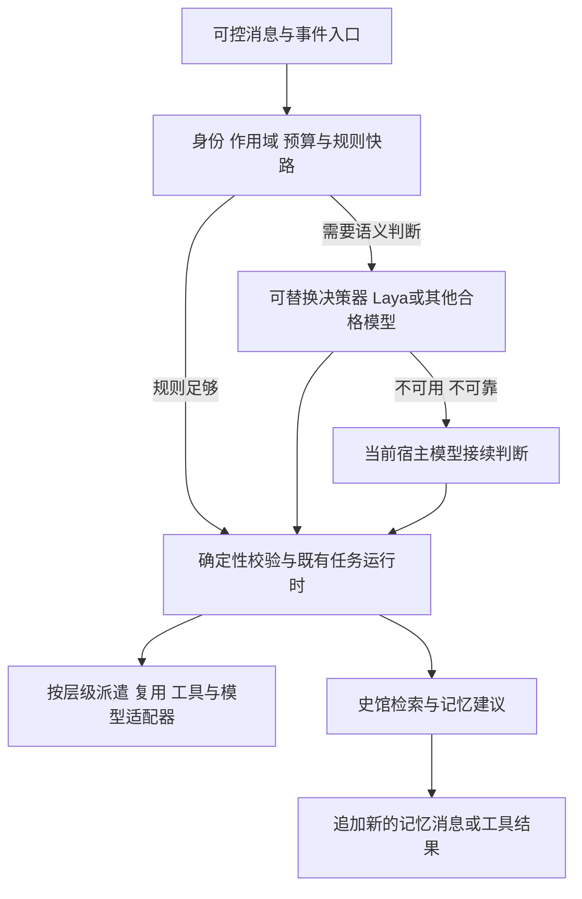

# 分层记忆、统一决策入口与 Rust / Node 演进计划

状态：PLANNED_UNVERIFIED。需求整理及分版本设计；不代表已实现、已安装或已验收。

本次仅修改计划与来源说明，不执行代码重构、训练、安装、迁移或发布。

日期：2026-11-01。关联：[版本总纲](2026-10-03-decretum-matrix-remediation-plan.md)、[一手来源与选型依据](../research/2026-11-01-memory-decision-gateway-sources.md)。

## 1. 需求与接受边界

1. 将腾讯分层记忆、有效期、经验演化、遗忘与召回机制内化到现有史馆 / GBrain，不建立第二份记忆权威。
2. 吸收 DeepSeek Superagent / Harness 的事件、任务分配、上下文订阅与恢复方法，保留三省六部的职责和直接上级链。
3. 决策范围覆盖大部分需要语义判断的环节：受理、派遣/复用/换新、官署/能力选择、模型路由、流程建议、结果辅助判断及记忆操作，不限于记忆检索。
4. 用户提出的“Laya 像 gateway，消息从统一入口分配”是目标表达。采用已有职责分层方法，Laya 是可替换的决策提供者，不将某模型固化为整个网关。
5. 本地模型不可用或不可靠时，宿主模型接续同一决策；确定性规则不额外调用模型。
6. **记忆只追加到当前上下文末尾**，不插入已发送的历史前部，不改写 system、工具定义或历史消息以刷新记忆。
7. Rust + Node 按模块渐进迁移，以减少启动、推理、IPC、Token 与工具交互总成本为目标，同时保持行为、状态和恢复兼容。
8. 本次只修改计划。所有新能力均为 PLANNED_UNVERIFIED；未来实施、训练、现用安装替换与外部动作各按当时授权办理。

文档承载基线为已克隆的 beta1.2.1 源码提交 `e249609bd1661f72970405cece017f9f6d19dc2e`。它不自动推进根 `workspace.yaml` 接受版本。总纲中 2026-10-03 的路径、版本和执行状态保留为历史记录，不作为本机当前状态证明。

## 2. 采用的架构与选型结论

采用 **统一事件入口 + 确定性策略 + 可替换语义决策器 + 现有宿主执行器**。参考 vLLM Semantic Router 的 signal / decision 分层，结合 DeepSeek Superagent 的确定性 gate 与模型 assessment 分离。统一入口覆盖可接入的用户消息、子智能体回奏、工具结果和任务事件；不要求每条消息都做一次模型推理。

### 2.1 复用顺序

- **架构采用**：现在将上述职责分层写入计划；消息接入、语义判断与副作用提交互相独立。
- **API 网关候选**：需要自管推理代理时优先验证 TensorZero 的 Rust 网关、既有路由/回退与观测能力。先复用兼容的现成能力；只有缺口被证实后才做最小适配。它不直接取代官署派遣器。
- **语义路由参照**：vLLM Semantic Router 作为信号、候选集、决策和策略版本的设计依据；其当前模型 runtime 仍有分阶段实现，不将整套最新版能力或 Laya 原生兼容视为已完成。
- **可靠性参照**：LiteLLM 的重试、超时、冷却与备用路由用于比较和对照，不因功能相似叠加三个网关；它不是本轮 Rust / Node 原生化的必装依赖。
- **托管宿主**：仅经公开插件、MCP、CLI 或可控调用点适配。宿主未暴露的内部模型调用与隐藏消息不宣称已被统一拦截。缺少接入能力时保留原生宿主路径。
- **部署决策**：beta1.3.6 依据兼容性、部署体积和净成本决定复用 TensorZero、轻适配或暂不新增物理网关。当前不安装任何候选，不自建与现有 runtime 竞争的总线、身份或账册。

### 2.2 消息与执行边界

- 在现有 task/event 身份上做入口适配，关联项目、会话、任务、消息种类、来源事件、当前授权与允许候选；沿用现有幂等与审计机制。
- 停止、取消、心跳、流式数据片段和已验证的机械转发走快速控制路径，不能等 Laya 或宿主语义推理才生效。
- 原始工具长输出只保留可定位引用及必要摘要；决策输入按需截取且显式标注覆盖范围，不把全会话反复送给小模型。
- 先计算合法候选，再允许模型在候选中建议。层级、scope/write_set、owner/lease、容量事实、模型显式指定、发布权限和事务边界始终由确定性消费者核对。
- 路由器可建议执行路径，但派遣/复用/唤醒仍由合法直接上级经宿主真实动作完成，不能以网关路由记录代替派遣证据。
- 模型输出不直接执行工具、写史馆或推进裁定状态。沿现有 runtime 复验与提交，不新建第二个执行权威。

## 3. 广泛语义决策与 Laya 的定位

现有服务主要使用 Laya 的编码器做相似记录检索。决策头的历史试验没有证明通用决策能力；本计划不把相似度当作校准概率，不把 kNN 结果冒充直接决策模型。

| 决策位置 | 本地决策候选 | 宿主模型接续职责 | 确定性边界 |
| --- | --- | --- | --- |
| 受理与任务分解 | 任务类型、是否需要拆分、候选职责 | 歧义理解、复杂拆解与说明 | 当前旨意、任务范围、计划绑定 |
| 子智能体生命周期 | 直接完成 / 派遣 / 同问题复用 / 换新建议 | 依赖与收益分析、复杂接续 | 直接上级、上下文余量、lease、容量与写集 |
| 官署、能力与工具 | 对已准入候选排序、是否需补充材料 | 长尾能力选择与解释 | registry、工具白名单、来源可信度 |
| 模型与执行路径 | 在允许池内按难度、成本、延迟建议 | 长尾路由和失败恢复判断 | 用户指定、host proof、模型配置及数据边界 |
| 流程与结果 | 下一步、异常类型、是否需复核的建议 | 开放式推理、证据解释与最终业务判断 | 状态机、证据存在性、回执目标与复核角色 |
| 记忆写入与分类 | 价值、重复/冲突、事实/经验/意图、挂载点 | 摘要、类名和经验表达 | 既有记忆裁定、词表版本、来源和写入资格 |
| 召回与上下文 | 是否召回、场景、时间过滤、候选重排、摘要预算 | 多跳检索与综合解释 | 项目/权限先过滤、有效期与追加协议 |
| 维护与遗忘 | 低价值、失效或冷却候选及理由 | 歧义冲突、撤销条件复核 | 保留策略、活动引用、pin、恢复与删除权限 |

### 3.1 决策契约与晋级

在既有公共 API / 事件中定义兼容扩展，至少关联：决策位置、输入覆盖范围、允许候选、建议动作、证据引用、decision_provider、模型/策略版本、置信度是否已校准、abstain、fallback_reason、耗时与计费统计。仅投影必要元数据，不把原始私密消息复制进审计。

Laya / 其他小模型 / 宿主模型使用同一输入边界与结果契约。choice / noul / score 只用于各自验证过的任务，复杂生成任务交宿主模型。先比较兼容的当前上游模型/运行库与成熟替代，再考虑领域微调或定制适配；不为坚持 Laya 而牺牲效果。

每个决策位置分别完成：规则与宿主基线 → 本地模型 shadow 观测 → 留出集校准 → 有限低风险采用 → 回放评估。不能以一个位置准确率高推导全部位置可自动采用。训练/校准数据按项目、主题、时间分离，去除历史答案标签泄漏；不擅自读取 pending/private 正文。

### 3.2 回退和故障恢复

| 条件 | 计划行为 |
| --- | --- |
| 明确规则足够或有效缓存命中 | 直接规则 / 缓存路径；不重复模型判断 |
| 本地模型缺失、启动失败、超时、队列过载 | 在总时限内切换当前宿主模型；熔断冷却后再小流量探测 |
| 未校准、低覆盖、分布外、候选过多、输入被截断、输出非法 | 本地模型 abstain，由宿主判断；高置信度不能单独抵消这些条件 |
| 多个本地决策矛盾或候选不在准入集合 | 保留诊断，交宿主重新判断，确定性门禁保持 |
| 宿主模型也不可用或不能可靠判断 | 仅执行已明确允许的规则动作；其余暂停并给可继续路径 |
| 物理网关不可达 | 宿主适配器退回原生宿主决策路径，仍执行既有门禁；不开放无约束直通 |

宿主回退优先使用当前宿主会话能力，不要求额外密钥、不静默换用户指定模型。限制总尝试次数、总时限与调用成本；宿主回退不得重新进入同一 Laya 路由形成循环。纯决策重试与有副作用操作分开，响应丢失先查既有回执，不重发派遣或写入。

### 3.3 职责与名称解耦的最新澄清

具体职责采用[唐制史实基线与现代适应化职责计划](2026-11-01-office-duties-and-name-decoupling-plan.md)。三省/六部的功能、真实实例和显示名分离，Laya与宿主按职责合同路由；中书任务提示采用统一语义骨架与按需扩展。古名、CEO/COO或人名不产生新的权限/派遣边，也不规定固定的企业职位对应。辅助角色不作为三省六部组成。

## 4. 分层记忆、遗忘与条件召回

### 4.1 在现有史馆上增加派生组织

- **当前任务工作集**：任务目标、约束、进度和来源引用，随任务推进；不替代 P00 与运行时权威。
- **事实 / 情节**：发生过什么、何时有效、何处产生；历史事实与当前仍有效的约束分别呈现。
- **可复用经验**：适用场景、前提、失败条件、证据和版本；通过成功复用逐步巩固。
- **意图 / 偏好**：用户显式意图、有效期、撤销和替代关系；不得仅由一次模型猜测固化。
- **代码 / 决策演化**：复用 Git 与既有证据引用表达版本变化，不导入第二份完整 Git 或第二套谱系。

这些层描述记忆用途，与史馆既有分类谱系正交；不复制腾讯层号或保留位为本产品已实现能力。来源、valid_from/valid_until、superseded_by、适用项目与版本、证据、复用反馈等复用现有记录或派生投影，并定义兼容缺字段行为。

### 4.2 遗忘是可解释的生命周期

| 动作 | 条件与限制 |
| --- | --- |
| 随时间降权 | 相同权限域内，在相关性基础上结合最近成功复用、有效期与时间衰减；参数按类型校准 |
| 从活跃召回退出 | 意图到期、用户撤销、被新事实替代、适用版本失效；可保留为标记清楚的历史事实 |
| 冷却候选 | idle ≥ 该类型策略 TTL，且无成功复用、无活动任务/证据引用、未 pin、非权威记录、无保留要求；先 shadow 统计 |
| 重新激活 | 明确历史查询或重新满足适用前提；重新核有效期与权限，不能因被检索就复活撤销指令 |
| 撤回/隐藏 | 冲突、重复或失效证据充分后，走既有受控写入形成可恢复标记和引用；不在读请求内偷偷硬删 |
| 物理清理 | 独立保留策略与明确授权；不能从时间衰减、低置信度或模型建议自动推导删除权 |

TTL、宽限期和各类衰减常数为版本化配置，计划不将上游 180 天直接设成全局删除天数。未配置时维持现有保留策略，仅报告候选。普通命中不等于成功复用；只有有结果反馈的实际使用才巩固，防止系统反复检索给自己加权。权威审计、仍被引用的证据与用户固定事实不因年龄自动消失。

### 4.3 召回条件与顺序

当前任务确需历史事实、用户明确询问历史、目标/场景变化或出现未解决冲突时触发；重复问题复用有效快照，任务无变化不每条心跳全库检索。先做用户/项目/任务作用域和授权过滤，再按时间、事实有效性与适用版本筛选，最后采用关键词 + 向量候选与可选 Laya 重排。历史问题可返回过期事实，但明确其历史时点。冷记忆可按需召回，撤销记忆不能恢复执行权。

## 5. 追加式记忆与缓存稳定性

本节为所有宿主适配器、路由和检索实现的硬性设计要求。

1. 已提交上下文前缀保持字节/结构顺序稳定：system、工具定义和已有消息不因召回更新而插入、重排或修改。
2. 新记忆以新的、宿主合法支持的消息或真实只读工具结果追加到当前末尾。工具结果必须关联实际 tool_call，不能伪造工具消息或提升为 system 权限。
3. 追加包只含任务相关增量、记忆 ID/版本、来源、有效期与必要说明，设总预算；无新信息不追加，同版本不反复追加。
4. 更正、撤销和替代以新消息引用旧版本，明确“旧结论不再适用”；不为维持缓存继续使用已撤销内容。
5. 工具/能力选择优先使用稳定工具定义与调用时准入，不随每次路由动态重写整个 tools schema。必须改变工具/系统策略或发生压缩时，显式进入新的 context epoch 并接受该前缀重新建立缓存。
6. 记忆到期不修改已经提交的旧消息；新决策忽略其活跃效力。上下文压缩时建立新的受控快照，保留来源与撤销状态，不宣称永不重建缓存。
7. 路由成本计算包含切换模型/端点造成的缓存损失，采用适用的会话亲和；用户显式指定和质量约束优先，不能为命中缓存强留不合适模型。
8. 验收对照连续请求前缀、追加去重、cache read/write tokens 与 TTFT；用实际宿主/提供商数据验证，不以“采用 append-only”宣称缓存命中得到保证。不新增哈希校验脚本。

## 6. Rust / Node 渐进迁移

Node 优先承担宿主适配、稳定 CLI/MCP 接入、类型化决策与现有 Web 集成；Rust 优先评估网关数据路径、过滤/索引/排序与高频协议处理。边界按真实性能剖析确定，不按语言偏好拆出额外网络跳数。

- beta1.3.5 盘点入口与依赖，先给只读/纯协议的无 Python 快路选点，继续保留复杂 YAML 的显式回退。
- beta1.3.6 先复用成熟 Rust 网关，再做最小 Node 适配，比较单进程原生绑定与独立进程通信；每一条实际路径只选一种主要边界，不强制两套并存。
- 高频过滤/排序等纯逻辑逐模块契约对照、shadow、可回滚切换；写入/安装/恢复的 Rust 迁移单列设计与故障验收，不能仅凭读路径更快就移交写权。
- 模型训练初期保留 Python；推理先复用现有服务并保持常驻/按需预热。Rust / Node 原生推理仅在 tokenizer、决策头、算子、输出和精度等价验证通过后试点，不假定 ONNX 或某 Rust 引擎已支持该 Laya 权重。
- 提供三平台兼容、二进制分发、依赖缺失、模型不可用和回滚方案；不要求普通使用者现场编译 Rust，不把原生包装 Python 子进程当作已脱 Python。
- 质量或净成本不达标时回退，并将后续写入/推理迁移列为后续版本候选；不承诺在一个版本内全量重写。

## 7. 分版本交付与新增依赖

原 F01–F27 / E1–E10 继续保留。以下是增补，不把历史已发布版本重新排号；较大的新工作不阻塞原缺陷修复，可经计划修订向后顺延并保留原因。每版新增项的实际晋级由其出口决定，不因写进路线图自动启用。

| 版本 | 新增工作 | 本版出口 / 回退 | 增补依赖 |
| --- | --- | --- | --- |
| beta1.2.2 | 统一入口与广泛决策的最小公共契约；Laya/宿主同契约、错误与abstain区分 | 只读契约和领域负结论对照通过；尚不新增执行权 | 无 |
| beta1.2.6 | 场景/时效过滤、条件召回、Laya重排shadow；追加式记忆最小通路 | warm刷新、跨项目隔离、前缀不变与去重对照；宿主/既有排序回退 | 1.2.2 |
| beta1.2.8 | 决策器、宿主回退、追加协议的契约和故障夹具纳入既有门禁 | 超时/断路/非法输出/递归/重复副作用等负例；不以桩证明模型质量或缓存命中 | 1.2.2、1.2.6 |
| beta1.2.9 | 事实/经验/意图派生投影、来源有效期与Laya写入/分类建议 | 归档身份完整、旧记录可读；模型建议不越过记忆裁定 | 1.2.2 |
| beta1.3.0 | 冷却/衰减/撤销候选shadow、缓存与决策观测 | 可控时钟回放、保留豁免、既有日志封顶；不自动物理删除 | 1.2.9，保留原1.2.5依赖 |
| beta1.3.1 | 统一决策入口试点：派遣/复用/换新、官署/能力/模型路由；可替换provider与熔断 | observe后分决策位置有限采用；真实host派遣证据与宿主回退 | 1.2.2、1.2.8，保留原1.2.1依赖 |
| beta1.3.2 | 记忆投影/策略更新、断点恢复与未来原生后端迁移事务设计 | 单写权威、重复消息幂等、中断与回滚；不在查询时写迁移 | 1.2.9、1.3.0，保留原1.2.3/1.2.4依赖 |
| beta1.3.3 | 全链E2E：消息→决策→派遣→记忆追加→恢复 | 真实/夹具证据分开；压缩、撤销、网关/Laya/宿主故障可回放 | 1.2.8、1.3.0、1.3.1、1.3.2 |
| beta1.3.4 | 决策来源、宿主接续、记忆保留/追加与缓存边界文档 | 文档可照做，用户不必理解内部路由即可完成正常任务 | 1.3.1、1.3.3，保留原1.2.4依赖 |
| beta1.3.5 | 入口依赖盘点、Node无Python快路选点及后端边界评估 | 基线/兼容/体积报告，允许不迁移；不新写YAML引擎 | 1.2.8、1.3.3，保留原1.2.7依赖 |
| beta1.3.6 | TensorZero复用试点、Rust/Node读路径与可选原生推理等价试点 | 实测净成本与契约等价；默认保留可切回后端，写迁移另验 | 1.2.8、1.3.1、1.3.2、1.3.5 |
| beta1.3.7 | 分决策位置评估质量、成本、cache收益、宿主回退率与原生化收益 | 原始数据、失败样本和采用/缩小/停止结论；不报预设节省比例 | 1.3.6，保留原1.2.6/1.2.9/1.3.0/1.3.3依赖 |
| beta1.3.8 | 决策provider/路由插件契约与只读治理UI评估 | 稳定接口、无静默扩权、暴露覆盖边界；不建第二套状态 | 1.3.1、1.3.6、1.3.7 |
| beta1.3.9 | 汇总稳定API、追加协议、回退兼容矩阵及后续Rust/Node扩大迁移条件 | 提供RC/继续beta的决策材料，未通过项继续实验；不自动冻结v1 | 保留原1.2.9/1.3.6/1.3.7/1.3.8依赖 |

## 8. 可验证接受条件

- [ ] 每类语义判断有独立规则/宿主基线、标注或接受结果、留出集、校准/abstain标准和实际provider记录。
- [ ] 不确定、分布外、长输入和候选数量变化不会仅凭原始置信度自动采用；Laya未胜过基线时可替换或继续宿主路径。
- [ ] 全链支持宿主回退；超时总预算、熔断、停止优先级、网关失效及无重复副作用有正负例。
- [ ] 分层记忆可追溯；有效期、撤销、保留豁免、冷却和重新激活在可控时钟下可回放。
- [ ] 同会话记忆增量只追加，前缀稳定；修正/压缩使用明确版本或epoch，cache收益有提供商/宿主实际数据。
- [ ] 原生化报告冷/暖启动、p50/p95端到端延迟、常驻内存、工具轮次、IPC、输入/缓存/输出Token、失败率和恢复耗时；同时报告样本量、硬件与不能归因的项。
- [ ] 三平台与托管宿主的接入覆盖逐项列明，未验证路径写NOT_RUN / PARTIAL；代码、安装、模型质量、缓存和真实宿主证据分别记录。
- [ ] 总纲与独立版本的正反依赖一致，所有新增项未填实施成功记录；无生产代码、版本、安装或发布改动。

## 9. 职责与工作方式的并行增补

本文件第7节的后续版本同时承接[职责与名称计划第6节](2026-11-01-office-duties-and-name-decoupling-plan.md#6-后续版本分批安排)：1.2.2职责/任务契约、1.2.8等价门禁、1.2.9历史记录、1.3.1协作路由、1.3.3真实host E2E、1.3.4工作手册、1.3.6跨语言等价、1.3.8身份skin、1.3.9兼容晋级。沿已存在前置关系，不新增平行依赖图；原记忆、回退、追加缓存和原生化要求继续适用。
